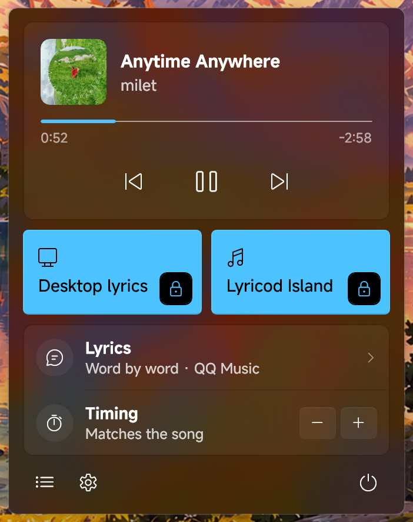

# Lyricod

## English | [简体中文](README.zh-CN.md)

Lyricod displays synced lyrics on Windows, with word-by-word highlighting, desktop lyrics, a lyric island at the top of the screen, and a separate lyrics window.

It works with Spotify, QQ Music, NetEase Cloud Music, Apple Music, and supported browser music players. Translations, pronunciation, timing, and appearance can be customized.

[Download Lyricod](https://github.com/Indarkdust/Lyricod-App/releases)

## Ways to view lyrics

### Lyricod Island

The island sits at the top of the screen by default and highlights lyrics word by word as the song plays. It adjusts its width to the current line and can show translations, pronunciation, or the next line under it. Lyric colours can follow the album artwork or use a colour you choose.

Hovering over the island can expand it into a mini player or hide it temporarily so you can use what's behind it. You can also combine both actions: the island hides when the pointer moves onto it. To expand the mini player, move across the island horizontally, then down (or up, for a floating island). The island can fade out after playback pauses.

How to expand the mini player with the mouse

To move the island somewhere else, switch to Floating mode in Settings > Lyricod Island. The floating island has rounded corners on all sides and can be dragged anywhere once unlocked: use the lock on the tray panel's Lyricod Island tile, or **Lock island position** on the same Settings page. Near screen edges, it expands inward to keep the lyrics and mini player on screen. While it's unlocked, hover actions and Lyricod Glass's effects are paused.

Lyricod Glass gives the island a transparent background. New installs on Windows 11 start with it, and you can switch between Lyricod Glass and the Classic island in Settings > Lyricod Island > Theme. The default Liquid effect adds a slight blur, edge refraction and highlights. You can also choose Clear or Frosted, and adjust transparency and tint. Liquid has extra settings for blur, refraction and a 3D effect (Off, Bright, Soft or the experimental Lifelike).

On supported Windows 11 versions, the live Liquid Glass island appears in screenshots and recordings, including NVIDIA Instant Replay. On older versions, the island may be hidden from capture to prevent visual feedback. You can temporarily show it using **Show in screenshots**.

### Desktop lyrics

Display lyrics above other windows: the current line, and under it the translation, pronunciation, both, or the next line. When locked, clicks pass through the lyrics. To drag them to a different position, unlock them with the lock on the tray panel's Desktop lyrics tile, or in Settings > Desktop lyrics.

### Lyrics window

View the whole song in a separate window, with optional album artwork in the background. Lyrics scroll with playback. With synced lyrics, clicking a line seeks to that point in the song if the player allows it. If you scroll the lyrics yourself, the window returns to the current line a few seconds after you stop. The window has its own playback controls; in a wide window or full screen, they fade out while music plays and the pointer is still. Press F11 for full screen.

In Settings > Lyrics window > Sung lyrics you can change how sung words are highlighted in this window: a colour sweep (the default), a glowing sweep, the whole line at once, or **Sweep with a lift**, where each word rises a little as it's sung.

### Tray panel

Lyricod also runs in the system tray. Open its tray panel to control playback, show, hide or lock the lyric views, choose lyrics, or adjust the current song's timing. You can set global shortcuts for common actions in Settings > Shortcuts.

## Supported players

Lyricod reads playback information through Windows media controls. If a player appears there, Lyricod can usually follow it. This includes Spotify, QQ Music, NetEase Cloud Music, Apple Music, and some browser music players.

When multiple players are open, Lyricod follows the one currently playing by default. You can also select a player in Settings > General.

Some players do not report an accurate playback position. In that case, Lyricod keeps time itself, which may cause lyrics to drift after pausing or seeking. See the NetEase Cloud Music section below for details.

For videos in browsers, Lyricod only displays lyrics when it can match the content to a song. You can disable lyric searches for browsers and other apps in Settings > Lyrics.

## Lyrics sources

Lyricod searches NetEase Cloud Music, QQ Music, and [LRCLIB](https://lrclib.net), starting with the platform you're listening on. Depending on the song and source, results may include word-by-word or line-synced lyrics, translations, and pronunciation. When one platform has a song word by word and the other only line by line, the word-by-word lyrics come with the translation from the platform you're listening on. Pronunciation can be highlighted as it's sung as well: QQ Music's romaji, and the pinyin, romaji or romanised Korean that Lyricod works out for word-by-word lyrics. Lyrics are cached on your PC for later playback.

If Lyricod finds the wrong song, open Choose Lyrics to compare search results and preview the lyrics before selecting one. Your choice and any timing adjustment are saved for that song, even if you clear the lyrics cache.

You can adjust timing for the current song from the tray panel or Settings > Lyrics. Settings > Lyrics also has an offset that applies to all songs.

## Download and install

Download the version for your PC from [Releases](https://github.com/Indarkdust/Lyricod-App/releases):

- **x64**: for most Windows PCs with Intel or AMD processors.
- **ARM64**: for Windows PCs with Arm processors.
- **Installer (setup.exe)**: installs for the current user without administrator access.
- **Portable (zip)**: extract the archive and run `Lyricod.exe`. Keep the `app` folder next to it.
- **Patch (patch-….zip)**: used by in-app updates. You don't need to download these.

Lyricod runs in the Windows system tray after launch. If no window appears, look for its icon in the notification area.

The app is currently unsigned, so Windows may display a warning the first time it runs. Check where you downloaded the file before deciding whether to proceed.

Lyricod checks for updates once a day. You can disable this in Settings > About. Both installed and portable versions support in-app updates. An update downloads only the changed files when it can, and the full version otherwise. You can also download a new version manually.

Settings, cached lyrics, downloaded fonts and an error log are stored in `%LOCALAPPDATA%\Lyricod` and are kept during updates. Uninstalling the app does not remove this folder; delete it manually if you want to remove the data as well.

When you report a problem, please include `lyricod.log` from that folder and the details shown in Settings > About > Diagnostics. The log can contain file paths with your Windows user name, so check it before sharing.

## NetEase Cloud Music lyrics out of sync?

NetEase Cloud Music generally reports which song is playing but does not provide Windows with its playback position. Lyricod therefore tracks time itself, so lyrics may drift after you pause or seek.

For more accurate synchronization, you can use **InfLink-rs**, a third-party plugin that runs through **BetterNCM**. Both are maintained by other developers and change how NetEase Cloud Music runs. Install them only if you are comfortable with that.

The easiest way is through Lyricod: open Settings > General > NetEase Cloud Music sync. Lyricod downloads [a small helper](https://github.com/darkdust-c/Lyricod-CM-Helper) to install BetterNCM and InfLink-rs, and verifies the downloaded files before installation. NetEase Cloud Music restarts during setup, and Windows asks for administrator permission, because NetEase Cloud Music is installed in Program Files.

This setting appears when NetEase Cloud Music is installed, and supports 64-bit NetEase Cloud Music 3.x. If you'd rather install them manually:

1. Quit NetEase Cloud Music. Download and run `betterncm_installer.exe` from [BetterNCM Installer releases](https://github.com/std-microblock/BetterNCM-Installer/releases/latest).
2. Open NetEase Cloud Music and install **InfLink-rs** from the BetterNCM plugin store. Alternatively, download `InfLink-rs.plugin` from [InfLink-rs releases](https://github.com/apoint123/inflink-rs/releases/latest) and copy it to `C:\betterncm\plugins`.
3. Restart NetEase Cloud Music. InfLink-rs enables **SMTC** by default. If Lyricod still can't detect playback progress, check the InfLink-rs settings.

Lyricod will detect the additional playback information automatically. You can check this in Settings > About > Diagnostics.

InfLink-rs has been tested with NetEase Cloud Music 3.1.20 through 3.1.43 and 2.10.13. If a player update causes problems, check for an updated plugin. BetterNCM can be removed by deleting `msimg32.dll` from the NetEase Cloud Music installation folder, or use Remove in Lyricod's Settings > General > NetEase Cloud Music sync if you installed it through Lyricod. Do not install the older InfLink alongside InfLink-rs.

## Customization

You can customize lyric fonts, sizes, colours, backgrounds, translations, pronunciation, island mode, theme and size, animations, hover behaviour, and global shortcuts. The island, desktop lyrics and lyrics window have separate display settings.

Lyrics use Microsoft YaHei by default. In Settings > General > Font you can choose another installed font, or download **MiSans** by Xiaomi or **LXGW WenKai Lite** (霞鹜文楷). Neither downloadable font is bundled with Lyricod: MiSans is subject to Xiaomi's licence, and LXGW WenKai Lite is an open font under the SIL Open Font License. Lyrics use a newly chosen font immediately; the rest of Lyricod's text uses it after a restart.

## Privacy

To find lyrics, Lyricod sends the song title and artist to NetEase Cloud Music and QQ Music, and the title, artist, album and duration to LRCLIB. If lyric lookups for browsers and other apps are enabled, the title and artist or channel of content playing there may also be used in searches. You can turn this off in Settings > Lyrics. No additional information about your browsing or viewing is sent.

The island's audio bars use Windows audio APIs to read audio information from the current player. Lyricod does not record, save, or upload audio. You can disable music-reactive bars in Settings > Lyricod Island.

Lyricod Glass's Liquid effect reads the part of the screen behind the island to draw the glass. The image stays on your PC and is not saved or uploaded. To turn this off, choose the Clear or Frosted effect, or the Classic island, in Settings > Lyricod Island.

NetEase Cloud Music sync downloads Lyricod CM Helper from GitHub only when you choose to set it up; the helper then downloads BetterNCM and InfLink-rs from their own releases.

Fonts are downloaded only when you choose to download one: MiSans from Xiaomi's servers, and LXGW WenKai Lite from GitHub.

Automatic update checks contact GitHub once a day and can be disabled in Settings > About. An update is downloaded from GitHub only when you choose to install it.

Lyricod's error log stays on your PC and is not uploaded.

## Requirements

- Windows 10 version 1809 or newer, x64 or ARM64.
- Music-reactive audio bars require Windows 11. On Windows 10, they use a preset animation.
- Lyricod Glass's Liquid effect requires Windows 11. On Windows 10, the island starts with the Classic theme; if you choose Lyricod Glass there, Clear is used in place of Liquid.

## Credits

Inspired by [Lyricify](https://github.com/WXRIW/Lyricify-App). Lyricod Island takes inspiration from WXRIW's Dynamic Lyrics Island design (CC BY-SA 4.0). QQ Music word-by-word lyric decryption code was ported from [Lyricify Lyrics Helper](https://github.com/WXRIW/Lyricify-Lyrics-Helper) (Apache License 2.0). Pinyin support uses [ToolGood.Words](https://github.com/toolgood/ToolGood.Words) (Apache License 2.0), and tray and window helpers use [WinUIEx](https://github.com/dotMorten/WinUIEx) (MIT). Lyricod Glass's liquid effect is drawn with [Win2D](https://github.com/microsoft/Win2D) by Microsoft.

Screenshots and demo GIFs may contain song lyrics, album artwork, and other third-party content for demonstration purposes. All such content belongs to its respective rights holders and is not covered by Lyricod's Apache License 2.0.

Lyrics belong to their respective copyright holders. Lyricod is not affiliated with Microsoft, NetEase, or Tencent.

## License

Lyricod is licensed under the [Apache License 2.0](LICENSE). Third-party code, assets, and licences are listed in [THIRD-PARTY-NOTICES.md](THIRD-PARTY-NOTICES.md).
